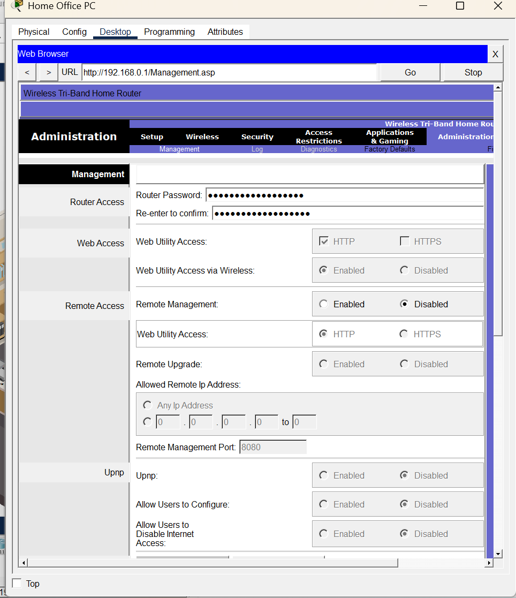
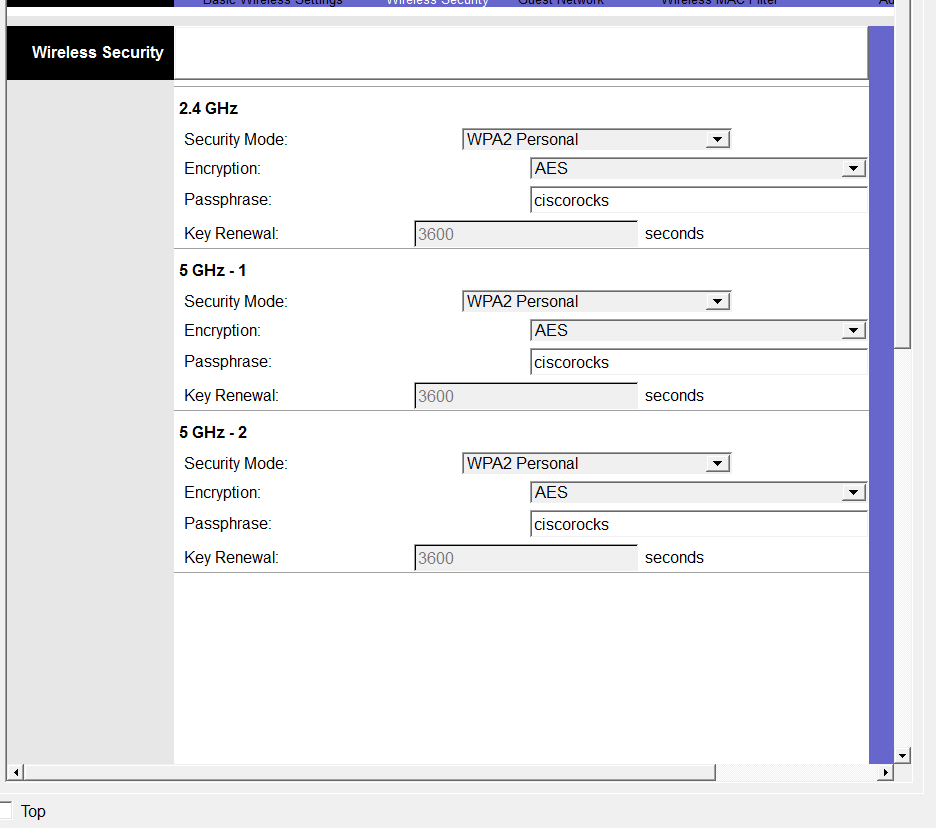
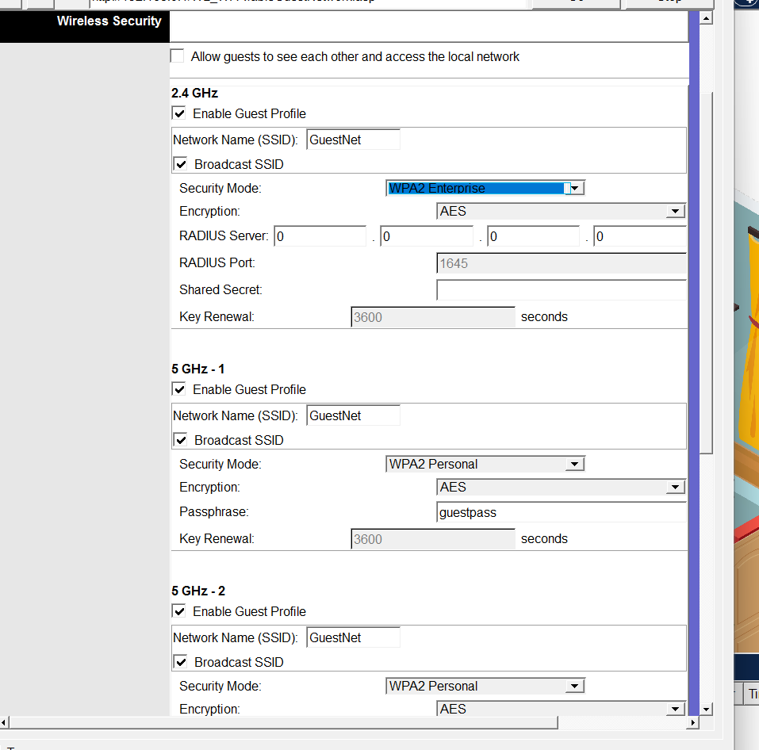

# Laboratório 03 — Segurança de Redes Wi-Fi e IoT

## 📌 Objetivo

Atuar como analista de segurança de redes, identificando e corrigindo configurações vulneráveis em um roteador doméstico simulado no Cisco Packet Tracer. O laboratório aborda proteção administrativa, segurança Wi-Fi, isolamento de convidados e conectividade de dispositivos IoT.

## 🔐 1. Proteção do roteador

- Alteração das credenciais administrativas padrão.
- Desativação do gerenciamento remoto para reduzir a exposição do roteador a acessos externos não autorizados.

## 📶 2. Segurança da rede Wi-Fi

- Configuração do SSID `HomeNet`.
- Ativação da segurança WPA2-Personal com criptografia AES nas bandas sem fio utilizadas.
- Verificação das configurações de segurança das diferentes bandas.

## 👥 3. Isolamento da rede de convidados

- Criação da rede Wi-Fi `GuestNet`.
- Configuração de uma rede separada para visitantes.
- Desativação da opção que permite aos convidados acessar a rede local.
- Teste de conectividade para verificar o isolamento entre a rede de convidados e a rede principal.

## 🤖 4. Dispositivos IoT

Foram configurados dispositivos inteligentes, como Webcam, Sirene e Porta, para utilizar a rede sem fio protegida. As configurações DHCP foram renovadas para obter endereços IP válidos.

## 🧪 Testes e validação

Foram verificadas as configurações de segurança do roteador, a proteção das redes Wi-Fi e a restrição de comunicação entre a rede de convidados e a rede local.

## 📚 Principais aprendizados

- Proteção de credenciais administrativas;
- Desativação do gerenciamento remoto;
- Segurança Wi-Fi com WPA2-Personal e AES;
- Isolamento de redes de convidados;
- Segurança de dispositivos IoT;
- DHCP e endereçamento IP;
- Testes de conectividade e validação de configurações.

## 🛠️ Ferramenta

- Cisco Packet Tracer

## 🎯 Conclusão

O laboratório demonstrou como configurações adequadas de segurança ajudam a reduzir riscos de acesso não autorizado, proteger comunicações sem fio e limitar o acesso de dispositivos convidados à rede principal.
