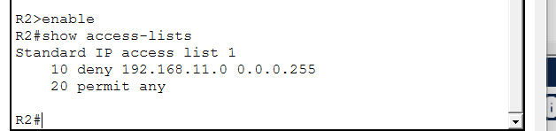
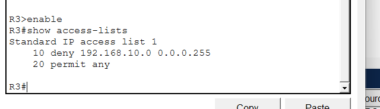
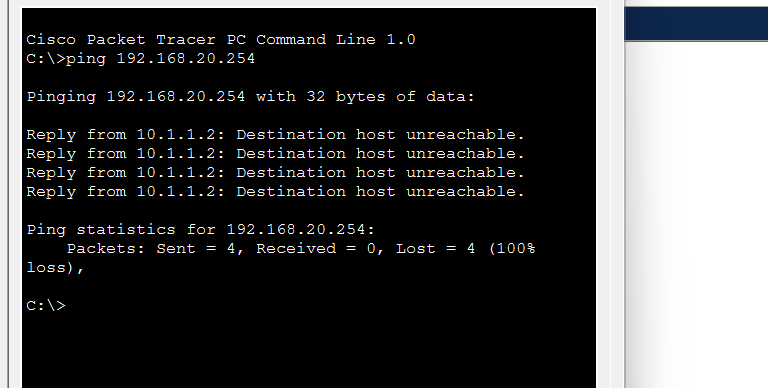

# Laboratório 05 – Configuração de ACLs IPv4 Padrão Nomeadas

## Sobre o laboratório

Neste laboratório, desenvolvido no **Cisco Packet Tracer**, foi realizada a configuração de ACLs (Access Control Lists) IPv4 padrão nomeadas, com o objetivo de restringir o acesso a um servidor de arquivos.

A atividade simulou um cenário em que apenas dispositivos autorizados poderiam acessar o servidor, enquanto todo o restante do tráfego deveria ser bloqueado.

## Objetivos

- Compreender o funcionamento das ACLs padrão nomeadas;
- Criar listas de controle de acesso utilizando nomes específicos;
- Permitir o acesso de dispositivos autorizados;
- Bloquear o tráfego de origem não autorizada;
- Aplicar e verificar as ACLs nas interfaces do roteador.

## Configurações realizadas

No roteador R1, foi criada uma ACL chamada `File_Server_Restrictions`, com as seguintes regras:

- Permissão para o endereço IP `192.168.20.4` (Web Manager PC1);
- Permissão para o endereço IP `192.168.100.100` (Web Server);
- Bloqueio de todo o tráfego restante com `deny any`.

A ACL foi aplicada no sentido de saída da interface FastEthernet 0/1, responsável pela conexão com o servidor de arquivos.

## Configuração da ACL

Registro da configuração da ACL padrão nomeada no roteador R1.

## Verificação e testes

Após a configuração, foram utilizados os comandos `show access-lists` e `show run` para verificar as regras e sua aplicação na interface.

Também foram realizados testes de conectividade utilizando o comando `ping`.

Os resultados esperados eram:
- As três estações de trabalho conseguem acessar o Web Server;
- Apenas o PC1 e o Web Server conseguem acessar o File Server;
- O acesso ao File Server pelos demais dispositivos é bloqueado.

## Tecnologias e conceitos

- Cisco Packet Tracer
- IPv4
- ACLs padrão nomeadas
- Controle de acesso
- Segurança de redes
- Configuração de roteadores

## Aprendizados

A atividade permitiu aprofundar os conhecimentos sobre ACLs IPv4, especialmente na utilização de listas nomeadas para controlar o acesso a recursos específicos da rede.

Também foi possível praticar a aplicação de políticas de segurança e a verificação das regras por meio de comandos e testes de conectividade.

**Ferramenta utilizada:** Cisco Packet Tracer.
